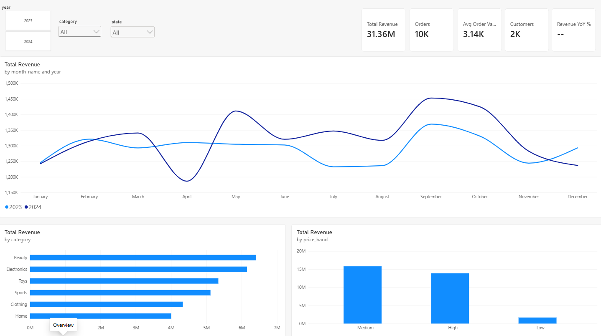
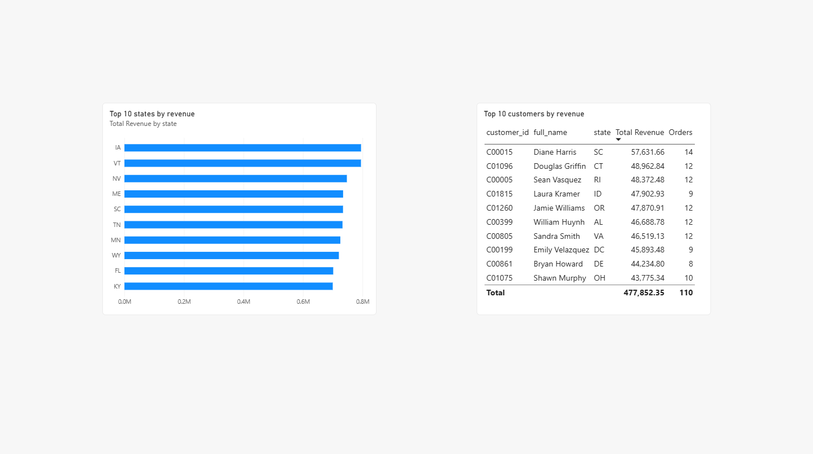

# Azure Retail Lakehouse: Unity Catalog, Medallion Pipeline and Power BI Dashboard

End-to-end data pipeline on **Azure Databricks**: raw Parquet files in ADLS Gen2 are ingested incrementally with **Auto Loader**, cleaned and validated in a **silver** layer, modelled as a **star schema** with surrogate keys in **gold**, orchestrated as one scheduled **Databricks Job**, and visualised in a **Power BI dashboard**.

**Tech stack:** Azure (ADLS Gen2, Managed Identity / Access Connector) · Databricks (Unity Catalog, Delta Lake, Auto Loader, Jobs, serverless) · PySpark · SQL · Power BI (DAX)

**Results:** 10,000 orders, 2,000 customers and 500 products loaded through bronze → silver → gold, with 0 duplicate keys, 0 orphaned records and every order joined to its customer, product and date.

## Power BI dashboard

Two report pages on the gold star schema: KPI cards (revenue, orders, average order value, customers, year-over-year growth), revenue by month for 2023 vs 2024, revenue by category and price band, top 10 states and top 10 customers, with year, category and state slicers synchronised across both pages.




## Architecture

```
ADLS Gen2 storage account
 ├── source      raw Parquet files, one folder per dataset
 ├── bronze      Auto Loader schemas + checkpoints
 ├── silver      cleaned tables
 ├── gold        star schema tables
 └── metastore   Unity Catalog root storage

Access Connector (managed identity) ── Storage Blob Data Contributor ──► storage account
        │
        ▼
Databricks workspace (serverless) ── Unity Catalog metastore
 └── catalog: databricks_catalog
      ├── bronze_schema   customers, orders, products, regions
      ├── silver_schema   customers, orders, products, regions
      └── gold_schema     fact_orders, dim_customer, dim_product, dim_date
```

| Layer | Purpose | Notebooks |
|---|---|---|
| Bronze | Raw files loaded incrementally into Delta tables, unchanged | `bronze_autoloader` |
| Silver | Cleaned, typed, deduplicated, validated | `silver_utils`, `silver_orders`, `silver_customers`, `silver_products`, `silver_regions`, `silver_checks` |
| Gold | Star schema with surrogate keys | `gold_dim_customer`, `gold_dim_product`, `gold_dim_date`, `gold_fact_orders` |
| Orchestration | One scheduled job, bronze → silver → gold | Databricks Job `medallion_pipeline` |
| Reporting | Power BI dashboard on the gold tables | `retail_sales_dashboard.pbix` |

## 1. Secure storage access with Unity Catalog

No storage keys are used. Databricks accesses ADLS Gen2 through a managed identity:

1. **Access Connector for Azure Databricks** with a system-assigned managed identity.
2. **Storage Blob Data Contributor** role for that identity on the storage account (covers all containers).
3. **Storage credential** in Unity Catalog pointing to the Access Connector.
4. **External locations**, one per container (`source`, `bronze`, `silver`, `gold`, `metastore`), all using that credential.
5. **Unity Catalog metastore** in the same region as the workspace, with the `metastore` container as root storage, and an admin **group** as metastore admin.
6. Each schema has its own managed location, e.g.:

```sql
CREATE SCHEMA IF NOT EXISTS databricks_catalog.silver_schema
MANAGED LOCATION 'abfss://silver@<storage-account>.dfs.core.windows.net/';
```

## 2. Bronze: dynamic incremental ingestion with Auto Loader

`bronze_autoloader` lists every folder in the `source` container and loads each one into its own bronze table. A new source folder is picked up automatically on the next run. Widgets allow loading a single folder or excluding folders.

```python
def ingest(folder: str) -> int:
    query = (
        spark.readStream
            .format("cloudFiles")
            .option("cloudFiles.format", file_format)
            .option("cloudFiles.schemaLocation", f"{STATE_ROOT}/_schemas/{folder}")
            .load(f"{SOURCE_ROOT}/{folder}/")
        .writeStream
            .option("checkpointLocation", f"{STATE_ROOT}/_checkpoints/{folder}")
            .trigger(availableNow=True)
            .toTable(f"{target_schema}.{folder}")
    )
    query.awaitTermination()
    ...
```

- The **checkpoint** records which files were processed, so each run loads only new files and never duplicates data.
- `trigger(availableNow=True)` processes everything new and stops, which suits serverless compute and scheduled jobs.
- Each folder is processed independently; a failure in one folder does not stop the others, and the notebook fails at the end so the job reports it.

## 3. Silver: reusable cleaning with `SilverTransformer`

`silver_utils` contains a chainable PySpark class, loaded with `%run ./silver_utils` in each silver notebook:

| Method | What it does |
|---|---|
| `trim()` | Remove spaces (all text columns by default) |
| `drop_nulls(*cols)` | Drop rows with missing key values |
| `filter(condition)` | Remove invalid values |
| `deduplicate(*keys)` | One row per key |
| `cast({col: type})` | Fix data types |
| `apply(func)` | Run a table-specific step |
| `add_processed_at()` | Add a processing timestamp |
| `write(table)` | Save as a Delta table |

Example, silver orders:

```python
(SilverTransformer.from_table("databricks_catalog.bronze_schema.orders")
    .trim("order_id", "customer_id", "product_id")
    .drop_nulls("order_id", "customer_id", "product_id", "order_date")
    .filter((F.col("quantity") > 0) & (F.col("total_amount") >= 0))
    .deduplicate("order_id")
    .cast({"total_amount": "decimal(12,2)"})
    .add_date_parts("order_date", prefix="order")
    .add_processed_at()
    .drop("_rescued_data")
    .write("databricks_catalog.silver_schema.orders"))
```

Table-specific cleaning:

| Table | Main steps |
|---|---|
| Orders | Valid keys, quantity > 0, amount ≥ 0, one row per order, money as `decimal(12,2)` |
| Customers | Consistent name/city case, lowercase email, `email_domain` column, uppercase state codes, `full_name` |
| Products | Price > 0, `decimal(12,2)`, `price_band` (Low / Medium / High), `discounted_price` (10% off) |
| Regions | Consistent ID and name case |

Design decisions: dates stay real `date` types (formatting only for display), and money uses `decimal` instead of `double` to avoid rounding errors.

## 4. Data quality checks

`silver_checks` runs before gold and verifies row counts, duplicate keys, null keys, referential integrity, value ranges and column types.

| Table | Bronze rows | Silver rows | Duplicate keys | Null keys |
|---|---|---|---|---|
| orders | 10,000 | 10,000 | 0 | 0 |
| customers | 2,000 | 2,000 | 0 | 0 |
| products | 500 | 500 | 0 | 0 |
| regions | 4 | 4 | 0 | 0 |

- Orders with unknown customer or product: **0** (checked with `left_anti` joins).
- Invalid quantities, negative amounts, non-positive prices, emails without `@`: **0**.
- Order date range: 2023-01-01 to 2024-12-31.

## 5. Gold: star schema with surrogate keys

```
                 dim_customer (2,000)
                      │ customer_key
                      │
dim_product ──── fact_orders ──── dim_date
   (500)          (10,000)          (731)
       product_key          date_key
```

| Table | Key | Content |
|---|---|---|
| `fact_orders` | `customer_key`, `product_key`, `date_key` | `quantity`, `total_amount`, `unit_price` |
| `dim_customer` | `customer_key` = `xxhash64(customer_id)` | Name, email domain, city, state |
| `dim_product` | `product_key` = `xxhash64(product_id)` | Name, category, brand, price, price band |
| `dim_date` | `date_key` = `yyyyMMdd` | Year, quarter, month, weekday, weekend flag (generated, one row per day) |

**Why hash-based surrogate keys:** the same business ID always produces the same key, so keys stay stable when tables are rebuilt and the fact table can compute them without lookups. Row numbers or `monotonically_increasing_id()` were avoided because they can change between rebuilds.

**Star schema check:** all 10,000 orders join to a customer, a product and a date (0 missing), and every key is unique in its dimension.

```sql
-- Example: revenue per category per year
SELECT p.category, d.year, SUM(f.total_amount) AS revenue
FROM databricks_catalog.gold_schema.fact_orders f
JOIN databricks_catalog.gold_schema.dim_product p ON f.product_key = p.product_key
JOIN databricks_catalog.gold_schema.dim_date    d ON f.date_key    = d.date_key
GROUP BY p.category, d.year
ORDER BY p.category, d.year;
```

## 6. Orchestration

One Databricks Job runs the whole pipeline on serverless compute, scheduled hourly:

```
               ┌─ silver_customers ── gold_dim_customer ──┐
               ├─ silver_products ─── gold_dim_product ───┤
load_bronze ───┼─ silver_orders ───── gold_dim_date ──────┼── gold_fact_orders
               │        └─────────────────────────────────┘
               └─ silver_regions
```

- Independent tasks run in parallel; if a task fails, dependent tasks are skipped, so gold is never built from partly updated data.
- New files in `source` reach the star schema automatically: Auto Loader picks up only new files, silver and gold rebuild from the layer below, and the hash keys stay identical.

## 7. Power BI

- Connected to the Databricks SQL warehouse (Azure Databricks connector, Import mode).
- Relationships `fact_orders` → each dimension on the surrogate keys (many-to-one); `dim_date` marked as date table.
- DAX measures:

```dax
Total Revenue = SUM(fact_orders[total_amount])
Orders = COUNTROWS(fact_orders)
Avg Order Value = DIVIDE([Total Revenue], [Orders])
Customers = DISTINCTCOUNT(fact_orders[customer_key])
Revenue Previous Year = CALCULATE([Total Revenue], SAMEPERIODLASTYEAR(dim_date[date]))
Revenue YoY % =
IF(
    HASONEVALUE(dim_date[year]),
    DIVIDE([Total Revenue] - [Revenue Previous Year], [Revenue Previous Year])
)
```

`Revenue YoY %` only returns a value when a single year is selected; otherwise it would compare both years combined with 2023 alone.

## Key challenges solved

| Challenge | Solution |
|---|---|
| Serverless-only workspace, no classic clusters | Auto Loader with `availableNow` triggers, serverless notebooks and jobs |
| Metastore storage required permissions the account admin role did not grant | Separate metastore admin group, ownership of the external location |
| Serverless streaming progress reported `None` row counts | Treat missing values as 0 when summarising loads |
| `%run` cycle error in the shared utilities notebook | Keep `%run` only in the calling notebooks |
| Top 10 customers returned 13 rows (duplicate names) | Rank by `customer_id` instead of name |
| Misleading year-over-year value with both years selected | `HASONEVALUE` guard in the DAX measure |